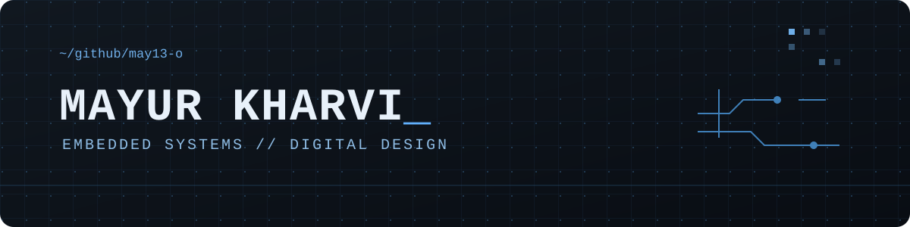
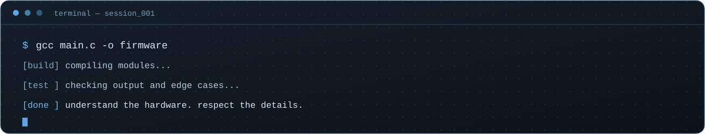
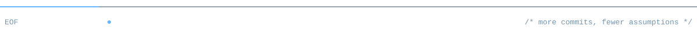

<div align="center">



<br>

[](https://github.com/may13-o)


</div>

## `whoami`

Electronics and Communication Engineering student interested in the space where **hardware meets software**.

I enjoy understanding how signals, circuits, microcontrollers and code work together — then turning that understanding into practical builds.

```c
while (curious) {
    learn();
    build();
    test();
    debug();
}
```

## `working_directory`

| Area | Exploring |
|---|---|
| Embedded systems | C, microcontrollers, ESP32, peripheral interfaces |
| Communication | Signals, modulation, DSP and SDR |
| Tools | MATLAB / Simulink, GNU Radio, Git, VS Code |

## `toolchain`

<p>
  
  
  
  
  
  
  </p>

## `selected_work`

A few things I'm building and learning through:

- **Embedded and IoT experiments** — working with development boards, sensors and serial interfaces.
- **Signal-processing exercises** — exploring filtering and communication concepts with MATLAB and Python.

> Replace or expand these entries as each repository reaches a presentable milestone. Keep this section focused on work you can explain and demonstrate.

## `currently_learning`

- Writing cleaner embedded C and understanding MCU peripherals.
- Applying signal-processing concepts to practical communication systems.

<div align="center">
  
  <br><br>
  <sub><code>0x00 → understand · 0x01 → implement · 0x02 → verify</code></sub>
  <br>
  
</div>
